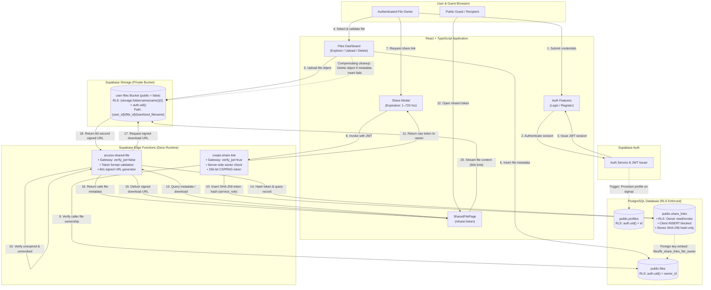

# CloudShare

CloudShare is a secure cloud-based file-sharing web application built with React, TypeScript, Tailwind CSS, and Supabase.

---

## 🚀 Development Roadmap

- **Phase 1: Project Planning and Foundation** *(Completed)*
- **Phase 2A: Architecture Restructuring** *(Completed)*
- **Phase 2B: Backend Architecture & Supabase Integration** *(Completed)*
- **Phase 3: Authentication Implementation** *(Completed)*
- **Phase 4: UI/UX Design System & File Dashboard** *(Completed)*
- **Phase 5: File Upload & Storage Management** *(Completed)*
- **Phase 6: File Sharing & Access Permissions** *(Completed)*
- **Phase 7: Security Hardening & Production Backend Deployment** *(Completed)*
- **Phase 8: Final Validation and Future Improvements** *(In Progress)*

> **Deployment & Verification Status Notice:**
> - Production database migrations and the private `user-files` storage bucket policies have been deployed and verified on Supabase.
> - Both Deno Edge Functions (`create-share-link` and `access-shared-file`) are deployed with hardened gateway configurations (`verify_jwt` enabled for authenticated owners; `--no-verify-jwt` enabled for public guest access).
> - All 81 automated tests in the Node.js test suite pass, covering authentication sanitization, file lifecycle operations, cryptographic hashing, fail-closed expiry validation, and schema foreign-key integrity.
> - Multi-tenant isolation is enforced server-side via PostgreSQL Row Level Security (RLS) and Storage object policies. *(Note: Live adversarial penetration testing across concurrent multi-account browser sessions remains an active validation task in Phase 8).*

---

## 🛠️ Technology Stack

- **Frontend:** React 18, TypeScript, Vite, Tailwind CSS, Lucide React
- **Cloud Platform:** Supabase (Auth, Storage, Database, RLS, Edge Functions)
- **Repository:** GitHub (`rohitt-prog/CloudVault`)
- **Tooling:** ESLint 9, PostCSS, Autoprefixer, Node Test Runner

---

## 🔍 How CloudShare Works

CloudShare implements an end-to-end, multi-tenant cloud storage and secure sharing architecture. User actions are mediated by defense-in-depth security boundaries spanning client validation, PostgreSQL Row Level Security (RLS), Supabase Storage policies, and cryptographically isolated Deno Edge Functions.

### System Architecture & Workflow Diagram



### Architectural Layer Responsibilities

| Architectural Layer | Core Responsibility & Security Enforcement |
|:---|:---|
| **Frontend (`frontend/`)** | User interface, client-side input validation, authentication session context, file explorer, and public guest view. Never touches privileged administrative keys. |
| **Supabase Auth** | User identity, password encryption, JWT issuance, and session token renewal. Fires automatic database triggers upon registration. |
| **PostgreSQL Database** | Relational metadata persistence, table-level constraints, composite foreign keys, and strict Row Level Security (RLS) policies scoped to `auth.uid() = owner_id`. |
| **Supabase Storage** | Encrypted object storage in the private `user-files` bucket (`public = false`). RLS policies enforce folder ownership using `(storage.foldername(name))[1] = auth.uid()::text`. |
| **Edge Functions (`functions/`)** | Privileged serverless backend boundary running on Deno. Handles secure share-link generation, file ownership verification, SHA-256 token hashing, fail-closed expiry checks, and 60-second signed download URL generation. |

---

### Core Application Workflows

#### A. User Authentication & Session Management
1. **Registration & Sign-In:** Users authenticate through `LoginForm` or `RegisterForm` using Supabase Auth.
2. **Session Persistence:** Upon successful authentication, Supabase Auth issues a JSON Web Token (JWT) containing the user's UUID (`auth.uid()`), which is persisted locally by the client library.
3. **Database Provisioning:** A database trigger (`on_auth_user_created`) automatically provisions a synchronized record in `public.profiles` executing under `SECURITY DEFINER` with an empty search path.
4. **Authorized Requests:** All subsequent database and storage requests automatically attach the user's JWT in the `Authorization: Bearer <token>` header, activating PostgreSQL Row Level Security.

#### B. File Upload & Multi-Tenant Storage Isolation
1. **Client-Side Validation:** The frontend validates the file size ($\le 50\text{ MiB}$), checks for empty files, and blocks dangerous executable extensions (`.exe`, `.bat`, `.cmd`, `.sh`, `.php`, etc.).
2. **Path Namespace Isolation:** A collision-resistant UUID and sanitized filename are generated to form an isolated storage path:
   ```text
   {authenticated_user_id}/{file_id}/{sanitized_filename}
   ```
3. **Storage Upload:** The binary stream is uploaded directly to the private `user-files` bucket. Supabase Storage RLS evaluates:
   ```sql
   (storage.foldername(name))[1] = (SELECT auth.uid()::text)
   ```
   Users are prohibited from writing to any folder prefix other than their own authenticated UUID.
4. **Metadata Insertion:** File metadata (filename, byte size, MIME type, storage path) is inserted into `public.files`. The table RLS policy verifies `WITH CHECK (auth.uid() = owner_id)`.
5. **Compensating Cleanup:** If the database metadata insertion fails after the binary has been uploaded, the frontend attempts a compensating cleanup request to delete the orphaned storage object, preventing storage leakage.

#### C. Privileged Secure Share-Link Generation
1. **Link Request:** The file owner opens the share dialog in the dashboard and selects an expiration duration between 1 hour and 720 hours (30 days, default 24 hours).
2. **Edge Function Mediation:** The frontend invokes the `create-share-link` Edge Function with the caller's JWT.
3. **Server-Side Authorization Check:** The Edge Function re-authenticates the caller's JWT using `supabase.auth.getUser()`. It then runs an administrative query verifying that the caller is the legitimate owner:
   ```sql
   SELECT id, owner_id FROM public.files WHERE id = $fileId AND owner_id = $userId;
   ```
   If the caller does not own the file, the function halts with HTTP 404 (`"File not found or permission denied"`), preventing owner enumeration.
4. **Cryptographic Token Generation:** The function generates 32 cryptographically secure random bytes (256 bits of entropy) using Web Crypto `crypto.getRandomValues()`, formatted as an unpadded 43-character Base64URL string (RFC 4648 §5).
5. **One-Way Token Hashing:** The function calculates the SHA-256 digest of the token.
6. **Privileged Insertion:** Using the `service_role` key, the function inserts `{ file_id, owner_id, token_hash, expires_at }` into `public.share_links`. (Standard client-side `INSERT` on `public.share_links` is strictly blocked by RLS).
7. **Raw Token Delivery & Hashed Storage:** The raw 43-character token is returned to the owner at creation to construct the share URL (`https://<origin>/share/<raw_token>`). Only its SHA-256 hash is stored in the database—the raw token is never persisted in database records or logged, permitting ongoing authorized access until the configured expiration or manual revocation.

#### D. Guest Access, Expiry, and Ephemeral Download
1. **Public Guest Navigation:** A recipient opens `https://<origin>/share/:token`. The route is served by `SharedFilePage` without requiring authentication.
2. **Public Edge Function Dispatch:** The frontend calls the `access-shared-file` Edge Function. The gateway allows unauthenticated access because the function is deployed with `--no-verify-jwt`.
3. **Token Format Validation:** The function checks that the token is a valid 43-character Base64URL string. Malformed tokens immediately receive a generic HTTP 404.
4. **Hash Matching & Relationship Embedding:** The function computes the SHA-256 digest of the token and queries `public.share_links` using an explicit foreign-key relationship:
   ```sql
   SELECT id, file_id, expires_at, revoked_at,
          files!fk_share_links_file_owner (id, file_name, file_size, mime_type, storage_path)
   FROM public.share_links
   WHERE token_hash = $tokenHash;
   ```
5. **Fail-Closed Lifecycle Verification:**
   - **Revocation Check:** If `revoked_at` is non-null, access is denied.
   - **Expiration Check:** Evaluates `!Number.isFinite(Date.parse(expires_at)) || Date.parse(expires_at) <= Date.now()`. Malformed or past timestamps fail closed.
6. **Safe Metadata Preview:** When `action === 'metadata'`, the function returns safe public attributes (`fileName`, `fileSize`, `mimeType`, `expiresAt`). The internal storage path, internal file UUID, and owner UUID are never exposed to the guest.
7. **Ephemeral Signed Download URL:** When `action === 'download'`, the function uses its internal service role to request a short-lived signed URL from Supabase Storage:
   ```ts
   storage.from('user-files').createSignedUrl(file.storage_path, 60, { download: file.file_name })
   ```
   The signed URL is valid for only **60 seconds**, strictly bounding access and preventing unauthorized secondary distribution.
8. **Uniform 404 Protection:** Any missing, revoked, expired, or malformed link request yields an identical HTTP 404 error payload, mitigating timing and link-enumeration attacks.
9. **Referrer Header Protection:** The single-page application enforces `<meta name="referrer" content="no-referrer" />` to ensure sharing tokens are not leaked in the HTTP `Referer` header when guests click outbound links.

---

## 📁 Directory Structure

```text
CloudVault/
├── .gitignore                      # Multi-tier secret and artifact ignore rules
├── README.md                       # Project documentation and developer guide
├── package.json                    # Minimal root delegating scripts
│
├── backend/
│   └── supabase/                   # Supabase BaaS infrastructure
│       ├── config.toml             # Local Supabase development configuration
│       ├── migrations/             # PostgreSQL schema migrations (DDL, triggers, RLS)
│       └── functions/              # Deno Edge Functions (privileged operations)
│           ├── _shared/            # Pure cryptographic & security utilities (zero-dependency)
│           ├── create-share-link/  # Generates cryptographically secure sharing links
│           └── access-shared-file/ # Guest access & signed download URL generator
│
├── docs/                           # Architecture & system specifications
│   ├── ARCHITECTURE.md             # System architecture & security boundaries
│   └── DATABASE_SCHEMA.md          # Database tables, RLS policies, and storage rules
│
└── frontend/                       # Decoupled React + TypeScript + Vite application
    ├── .env.example                # Frontend environment configuration template (Anon key only)
    ├── eslint.config.js            # Frontend ESLint configuration
    ├── index.html                  # Single-page application HTML entry point
    ├── package.json                # Frontend dependencies and scripts
    ├── package-lock.json           # Frontend dependency lockfile
    ├── postcss.config.js           # PostCSS configuration
    ├── tailwind.config.js          # Tailwind CSS configuration
    ├── tsconfig.json               # Frontend TypeScript project references
    ├── tsconfig.app.json           # Application TypeScript configuration
    ├── tsconfig.node.json          # Vite Node tooling TypeScript configuration
    ├── vite.config.ts              # Vite build configuration with @/ alias
    │
    ├── public/                     # Static public assets
    │   └── favicon.svg             # Application favicon
    │
    ├── src/                        # Frontend source code
    │   ├── app/                    # Application initialization, router, and providers
    │   │   ├── App.tsx             # Composed root application shell
    │   │   ├── router.tsx          # Route dispatcher
    │   │   ├── router-context.ts   # Navigation context
    │   │   └── providers/          # Global providers (Auth, Router)
    │   ├── components/             # Shared presentation components
    │   │   ├── layout/             # Shell components (Header, etc.)
    │   │   └── ui/                 # Atomic design components (Button, Input, etc.)
    │   ├── constants/              # Application constants & limits
    │   ├── features/               # Domain-driven business verticals
    │   │   ├── auth/               # Authentication components, hooks, services, types
    │   │   ├── files/              # File explorer, upload workflows, services, types
    │   │   └── sharing/            # Link generation, access verification, services, types
    │   ├── hooks/                  # Global hooks
    │   ├── lib/                    # Library configurations (Supabase client)
    │   ├── pages/                  # Route-level page components (Home, Login, Register, SharedFilePage)
    │   ├── services/               # Shared services
    │   ├── types/                  # Cross-domain type exports and database contracts
    │   ├── utils/                  # Pure utility helper functions (cn, formatting)
    │   ├── App.tsx                 # Root entry wrapper
    │   ├── index.css               # Global Tailwind CSS directives
    │   ├── main.tsx                # Application DOM entry point
    │   └── vite-env.d.ts           # Vite client environment declarations
    │
    └── tests/                      # Frontend unit test suites
        ├── auth-validation.test.js # Authentication validation tests
        ├── file-management.test.js # File categorization, formatting, isolation tests
        ├── file-operations.test.js # File upload validation, storage path, and operation workflow tests
        └── sharing-operations.test.js # Token cryptography, format validation, and share service tests
```

---

## 🚦 Getting Started

### 1. Install Frontend Dependencies
```bash
cd frontend && npm install
```
*(Or from the repository root: `npm --prefix frontend install`)*

### 2. Environment Setup
Copy the example environment configuration inside `frontend/`:
```bash
cp frontend/.env.example frontend/.env
```

Configure your Supabase credentials in `frontend/.env`:
```env
VITE_SUPABASE_URL=https://your-project-id.supabase.co
VITE_SUPABASE_ANON_KEY=your-anon-key-here
```
> **Security Notice:** Never expose `SUPABASE_SERVICE_ROLE_KEY` in frontend environment variables. Only the public anon key (`VITE_SUPABASE_ANON_KEY`) should ever be included.

### 3. Development Server
Run from repository root:
```bash
npm run dev
```
*(Delegates to `npm --prefix frontend run dev`)*

### 4. Build for Production
Run from repository root:
```bash
npm run build
```
*(Delegates to `npm --prefix frontend run build`)*

### 5. Lint Codebase
Run from repository root:
```bash
npm run lint
```
*(Delegates to `npm --prefix frontend run lint`)*

### 6. Run Test Suites
Run from repository root:
```bash
npm test
```
*(Delegates to `npm --prefix frontend run test`)*

---

## ⚡ Supabase CLI Usage

Supabase backend assets reside in `backend/supabase/`. When invoking the Supabase CLI from the repository root, supply the global `--workdir backend/supabase` flag:

```bash
# Start local Supabase development stack
supabase --workdir backend/supabase start

# Check local Supabase stack status
supabase --workdir backend/supabase status

# Reset local database and run migrations
supabase --workdir backend/supabase db reset

# Test Edge Functions locally
supabase --workdir backend/supabase functions serve
```
*(Alternatively, change directory first: `cd backend/supabase && supabase <command>`)*
