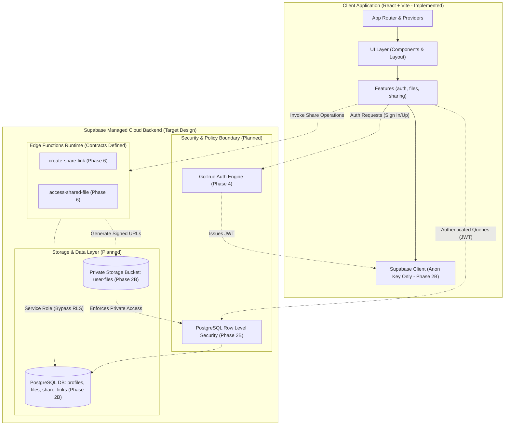

# CloudShare Architecture Documentation

> [!IMPORTANT]
> **Design Status Notice:**
> The current repository contains the **frontend architecture foundation** and **Supabase architectural design specifications**.
>
> **Supabase database tables, Row Level Security (RLS) policies, Storage buckets, database triggers, and Edge Function runtime execution logic are NOT yet deployed or operational.**
>
> The backend sections in this document describe the **target architecture** for subsequent implementation phases (Phases 2B through 8).

---

## Current Implementation vs. Planned Components

| Component / Subsystem | Current Status | Target Implementation Phase |
|---|:---:|:---:|
| **Frontend Feature Architecture (`frontend/src/app/`, `features/`, `components/`)** | **Implemented** | Phase 2A |
| **Domain TypeScript Type Contracts (`auth`, `files`, `sharing`)** | **Implemented** | Phase 2A |
| **Vite & TypeScript Strict Mode Tooling** | **Implemented** | Phase 1 & 2A |
| **Supabase Configuration (`backend/supabase/config.toml`)** | **Implemented** | Phase 2A |
| **Edge Function Type Contracts & Definitions** | **Implemented** | Phase 2A |
| **Supabase Client SDK (`@supabase/supabase-js`)** | **Implemented** | Phase 2B |
| **PostgreSQL Database Tables (`profiles`, `files`, `share_links`)** | **Implemented in Migration (Deployment Pending)** | Phase 2B |
| **Database Triggers (`on_auth_user_created`, `handle_updated_at`)** | **Implemented in Migration (Deployment Pending)** | Phase 2B |
| **Row Level Security (RLS) Policies** | **Implemented in Migration (Deployment Pending)** | Phase 2B |
| **Private Supabase Storage Bucket (`user-files`) & Storage RLS** | *Planned (Not Deployed)* | Phase 2B / Phase 5 |
| **Authentication Flow & Session Management (`features/auth`)** | **Implemented** | Phase 3 |
| **File Management & Dashboard (`features/files`)** | **Implemented** | Phase 4 |
| **File Upload & Storage Operations (`features/files`)** | *Planned* | Phase 5 |
| **Edge Function Runtime Logic (Token validation & Signed URLs)** | *Planned (Not Deployed)* | Phase 6 |

---

## 1. System Overview

CloudShare is a secure cloud-based file-sharing web application designed on a modern decoupled architecture:
1. **Frontend:** React 18, TypeScript, Vite, Tailwind CSS, Lucide React.
2. **Backend Services (Target):** Supabase (Auth, PostgreSQL Database, Private Storage, Row Level Security, Edge Functions).

In the target architecture, there is **no standalone Node.js, Express, or FastAPI server**. The React client will communicate directly with Supabase via the official Supabase JavaScript SDK using the public anonymous key (`VITE_SUPABASE_ANON_KEY`), while all authorization, data integrity, and multi-tenant isolation will be enforced at the PostgreSQL database layer (via Row Level Security) and isolated serverless Supabase Edge Functions.



---

## 2. Directory Structure & Responsibilities

The codebase follows a decoupled architecture separating the frontend client application, root documentation, and Supabase BaaS configurations:

```text
CloudVault/
├── .gitignore                      # Multi-tier secret and artifact ignore rules
├── README.md                       # Project documentation and phase roadmap
├── package.json                    # Minimal root delegating scripts
│
├── backend/
│   └── supabase/                   # Supabase BaaS infrastructure
│       ├── config.toml             # Local Supabase development configuration
│       ├── migrations/             # PostgreSQL schema migrations (DDL, triggers, RLS policies)
│       └── functions/              # Deno-based Edge Functions for privileged operations
│           ├── create-share-link/  # Generates cryptographically secure sharing links
│           └── access-shared-file/ # Validates tokens, checks expirations, issues signed download URLs
│
├── docs/                           # System design, architecture, and schema documentation
│   ├── ARCHITECTURE.md             # Architecture specifications and security boundary definitions
│   └── DATABASE_SCHEMA.md          # Proposed PostgreSQL tables, relationships, and RLS policies
│
└── frontend/                       # Decoupled React + TypeScript + Vite application
    ├── .env.example                # Template for frontend environment variables (Anon key only)
    ├── eslint.config.js            # Frontend ESLint configuration
    ├── index.html                  # Single-page application HTML entry shell
    ├── package.json                # Frontend package dependencies & scripts
    ├── package-lock.json           # Frontend dependency lockfile
    ├── postcss.config.js           # PostCSS configuration
    ├── tailwind.config.js          # Tailwind CSS configuration
    ├── tsconfig.json               # Frontend TypeScript project references
    ├── tsconfig.app.json           # Application TypeScript configuration
    ├── tsconfig.node.json          # Vite tooling TypeScript configuration
    ├── vite.config.ts              # Vite configuration with @/ alias
    │
    ├── public/                     # Static public assets
    │   └── favicon.svg             # Application favicon
    │
    ├── src/                        # Frontend source code
    │   ├── app/                    # Application initialization, root wrapper, router, and global providers
    │   │   ├── App.tsx             # Root container composing providers and routing
    │   │   ├── router.tsx          # Declarative route dispatcher
    │   │   ├── router-context.ts   # Navigation context
    │   │   └── providers/          # Composable application-wide context providers
    │   ├── components/             # Shared presentation components (feature-agnostic)
    │   │   ├── ui/                 # Atomic UI primitives (Button, Input)
    │   │   └── layout/             # Structural shell components (Header)
    │   ├── constants/              # Application-wide constants, limits, and configuration keys
    │   ├── features/               # Domain-driven feature modules (isolated business verticals)
    │   │   ├── auth/               # Authentication state, login/registration UI, auth hooks & types
    │   │   ├── files/              # File explorer, upload workflows, file management hooks & types
    │   │   └── sharing/            # Link generation, access verification, permission rules & types
    │   ├── hooks/                  # Global application hooks
    │   ├── lib/                    # External library instances and integrations (Supabase client)
    │   ├── pages/                  # Route-level page components (views assembled from features)
    │   ├── services/               # Shared service interfaces
    │   ├── types/                  # Cross-domain type exports and global application contracts
    │   ├── utils/                  # Pure utility functions (string formatting, byte size calculation, cn)
    │   ├── App.tsx                 # Root entry wrapper component
    │   ├── index.css               # Global Tailwind CSS directives
    │   ├── main.tsx                # Vite DOM entry point
    │   └── vite-env.d.ts           # Vite client environment typing
    │
    └── tests/                      # Frontend unit test suites
        ├── auth-validation.test.js # Authentication validation tests
        └── file-management.test.js # File dashboard filtering and isolation tests
```

### 2.1 Supabase CLI Invocation
Backend assets are located in `backend/supabase/`. To execute Supabase CLI commands from the repository root, use the global `--workdir backend` flag:

```bash
# Start local Supabase development environment
supabase --workdir backend start

# Run database migrations locally
supabase --workdir backend db reset

# Deploy or inspect Edge Functions locally
supabase --workdir backend functions serve
```
*(Or navigate directly to the backend directory: `cd backend && supabase <command>`)*

---

## 3. Communication Architecture & Boundaries (Target Design)

### 3.1 Client-to-Supabase Communication
- **Protocol:** HTTPS REST (PostgREST API) and WebSockets (Supabase Realtime).
- **Client Configuration:** Only the **Supabase URL** (`VITE_SUPABASE_URL`) and the **Public Anon Key** (`VITE_SUPABASE_ANON_KEY`) will be bundled into client code.
- **Identity Context:** When a user logs in, GoTrue will issue a signed JWT containing their `sub` (User UUID). Every subsequent client request will include this JWT in the `Authorization: Bearer <JWT>` header. PostgreSQL will automatically extract `auth.uid()` from this token to evaluate Row Level Security (RLS) rules.

### 3.2 Service Role Protection Boundary
> [!CAUTION]
> **Zero Leakage Rule:** The Supabase `service_role` key bypasses all Row Level Security policies. **It must NEVER appear in client-side code, `.env`, or browser bundles.**
>
> If an operation requires elevated permissions (such as generating guest download tokens or validating password hashes for unauthorized users), that operation will be strictly isolated inside **Supabase Edge Functions** running on the Supabase infrastructure.

---

## 4. Subsystem Responsibilities (Target Design)

### 4.1 Authentication Responsibility (Planned: Phase 4)
- **Provider:** Supabase Auth (GoTrue).
- **Client Role:** Will manage login, registration, password recovery forms, and authentication state (`useAuth` hook). Will store session securely in browser local storage via the SDK.
- **Database Hook:** An automated PostgreSQL trigger (`on_auth_user_created`) will provision a matching record in the public `profiles` table whenever a new user registers in `auth.users`.

### 4.2 File Storage Responsibility (Planned: Phase 2B / Phase 5)
- **Storage Engine:** Supabase Storage (S3-compatible object storage).
- **Bucket Configuration:** Single private bucket named `user-files` with public access disabled (`public = false`).
- **Access Control:** Storage policies will enforce that:
  - Users can only upload objects into a path prefixed with their own UUID: `{user_id}/{file_id}/{filename}`.
  - Users can only read, update, or delete objects within their own directory prefix.
  - Direct anonymous HTTP access to storage buckets will be completely blocked.

### 4.3 Secure Sharing Responsibility (Planned: Phase 6)
- **Challenge:** Enabling an unauthenticated or guest recipient to view or download a specific private file without granting them direct access to the owner's private storage bucket.
- **Planned Solution — Edge Function Mediation:**
  1. **Link Creation:** The authenticated owner will invoke the `create-share-link` Edge Function. The function will generate a high-entropy share token, calculate expiration time, optionally hash a password, and store the record in `share_links`.
  2. **Link Access:** A guest recipient will navigate to `/share/:token` and invoke the `access-shared-file` Edge Function.
  3. **Verification & Delivery:** The function will verify token existence, check whether `expires_at` has passed, validate download limits, check the optional password, increment `download_count`, and issue a **short-lived signed URL** (valid for 60 seconds) directly to the specific file.
  4. The guest will download the file via the temporary signed URL without ever gaining persistent access or viewing storage folder hierarchies.

### 4.4 Row Level Security (RLS) Boundary (Planned: Phase 2B)
Row Level Security will serve as the primary security wall. Every table in the `public` schema (`profiles`, `files`, `share_links`) will have RLS enabled (`ALTER TABLE ... ENABLE ROW LEVEL SECURITY`).
- `profiles`: Authenticated users can read public profile details, but will only be permitted to update their own profile (`auth.uid() = id`).
- `files`: Authenticated users will only be permitted to SELECT, INSERT, UPDATE, or DELETE files where `owner_id = auth.uid()`.
- `share_links`: File owners will be permitted to manage share links for files they own. Direct guest queries via PostgREST will be disallowed; all guest interactions will be mediated through Edge Functions.
