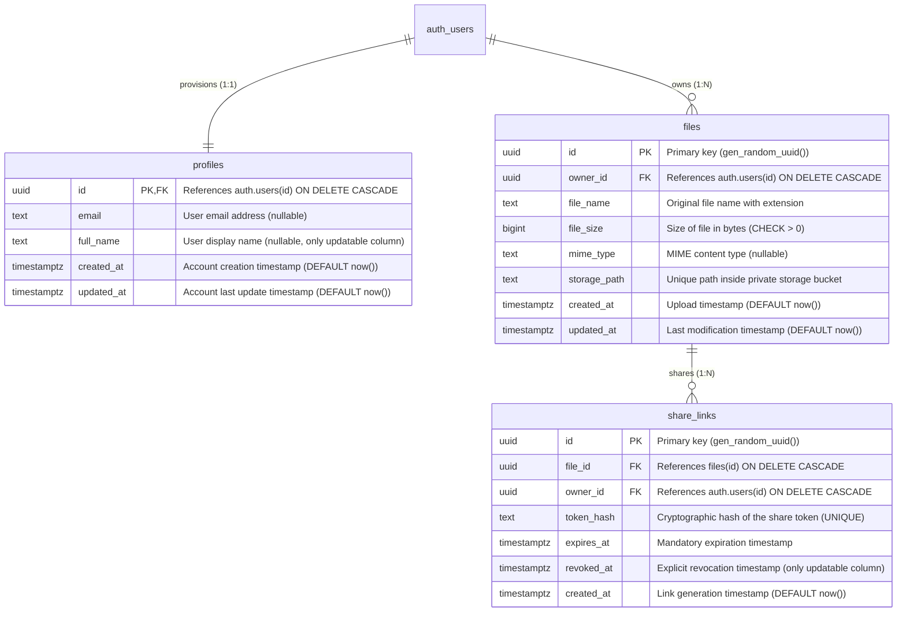

# CloudShare Database Schema Specification

> [!IMPORTANT]
> **Implementation & Security Hardening Status:**
> - **Migration File:** Hardened in place in `backend/supabase/migrations/20261114191500_create_base_schema.sql`.
> - **Column-Level Privilege Hardening:** Active in migration:
>   - Authenticated users may update only `full_name` on `profiles`. Direct updates to `id`, `email`, `created_at`, or `updated_at` are revoked.
>   - Authenticated users may update only `revoked_at` on `share_links`. Direct updates to `token_hash`, `file_id`, `owner_id`, `expires_at`, `id`, or `created_at` are revoked.
>   - Share link insertion is strictly backend-controlled; client roles cannot insert share links.
> - **Trigger Security:** Trigger functions run with `SECURITY DEFINER` and `SET search_path = ''` with fully qualified database objects, and direct execution is revoked from public roles.
> - **Timestamps:** Standardized on `now()` for defaults, provisioning, and triggers.
> - **Deployment Status:** **Pending.** Migrations have not yet been applied to a live remote Supabase instance.
> - **Storage Bucket Migration:** `backend/supabase/migrations/20261114213000_create_storage_bucket.sql` provisions private bucket `user-files` and configures storage RLS on `storage.objects` (Deployment Pending).

---

## 1. Schema Entity Relationship Diagram



---

## 2. Table Specifications & Constraints

### 2.1 Table: `public.profiles`
Stores user profile information, automatically synchronized from `auth.users` upon signup.

| Column | Type | Constraints | Description |
|---|---|---|---|
| `id` | `UUID` | `PRIMARY KEY REFERENCES auth.users(id) ON DELETE CASCADE` | Matches Supabase Auth user UUID |
| `full_name` | `TEXT` | Nullable | User display name (Only column updatable by authenticated users) |
| `email` | `TEXT` | Nullable | User primary email |
| `created_at` | `TIMESTAMPTZ` | `NOT NULL DEFAULT now()` | Record creation timestamp |
| `updated_at` | `TIMESTAMPTZ` | `NOT NULL DEFAULT now()` | Record modification timestamp |

**Indexes:**
- `CREATE INDEX idx_profiles_email ON public.profiles(email);`

---

### 2.2 Table: `public.files`
Stores file metadata for objects uploaded into private cloud storage.

| Column | Type | Constraints | Description |
|---|---|---|---|
| `id` | `UUID` | `PRIMARY KEY DEFAULT gen_random_uuid()` | Unique file identifier |
| `owner_id` | `UUID` | `NOT NULL REFERENCES auth.users(id) ON DELETE CASCADE` | Owning user UUID |
| `file_name` | `TEXT` | `NOT NULL` | Original filename |
| `storage_path` | `TEXT` | `NOT NULL UNIQUE` | Unique relative storage key in bucket |
| `file_size` | `BIGINT` | `NOT NULL CHECK (file_size > 0)` | Byte size (positive integer) |
| `mime_type` | `TEXT` | Nullable | MIME format string |
| `created_at` | `TIMESTAMPTZ` | `NOT NULL DEFAULT now()` | Upload timestamp |
| `updated_at` | `TIMESTAMPTZ` | `NOT NULL DEFAULT now()` | Last update timestamp |

**Constraints:**
- `CONSTRAINT uq_files_id_owner UNIQUE (id, owner_id)`: Composite uniqueness required for relational link ownership constraint.

**Indexes:**
- `CREATE INDEX idx_files_owner_id ON public.files(owner_id);`
- `CREATE INDEX idx_files_storage_path ON public.files(storage_path);`
- `CREATE INDEX idx_files_created_at ON public.files(created_at DESC);`

---

### 2.3 Table: `public.share_links`
Stores time-limited, revocable share link tokens for files.

| Column | Type | Constraints | Description |
|---|---|---|---|
| `id` | `UUID` | `PRIMARY KEY DEFAULT gen_random_uuid()` | Unique link record ID |
| `file_id` | `UUID` | `NOT NULL` | References target file |
| `owner_id` | `UUID` | `NOT NULL` | References file owner |
| `token_hash` | `TEXT` | `NOT NULL UNIQUE` | Cryptographic hash (SHA-256) of access token (raw token never stored) |
| `expires_at` | `TIMESTAMPTZ` | `NOT NULL` | Mandatory expiration date |
| `revoked_at` | `TIMESTAMPTZ` | Nullable | Revocation timestamp (Only column updatable by authenticated owners) |
| `created_at` | `TIMESTAMPTZ` | `NOT NULL DEFAULT now()` | Creation timestamp |

**Integrity Constraints:**
- `CONSTRAINT fk_share_links_file_owner FOREIGN KEY (file_id, owner_id) REFERENCES public.files (id, owner_id) ON DELETE CASCADE`:
  Mathematically guarantees that a share link's `owner_id` matches the owner of the referenced file.
- `CONSTRAINT chk_expires_after_created CHECK (expires_at > created_at)`: Link expiration must be in the future.
- `CONSTRAINT chk_revoked_after_created CHECK (revoked_at IS NULL OR revoked_at >= created_at)`: Revocation must be after creation.

**Indexes:**
- `CREATE INDEX idx_share_links_file_id ON public.share_links(file_id);`
- `CREATE INDEX idx_share_links_owner_id ON public.share_links(owner_id);`
- `CREATE INDEX idx_share_links_token_hash ON public.share_links(token_hash);`
- `CREATE INDEX idx_share_links_expires_at ON public.share_links(expires_at);`

---

## 3. Row Level Security & Column-Level Permissions

All tables have Row Level Security enabled in `backend/supabase/migrations/20261114191500_create_base_schema.sql`.

### 3.1 `profiles` Security
- **SELECT:** `auth.uid() = id` (Users can only read their own profile).
- **UPDATE:** `auth.uid() = id` with check `auth.uid() = id`.
- **Column Privilege Hardening:**
  ```sql
  REVOKE UPDATE ON TABLE public.profiles FROM PUBLIC, anon, authenticated;
  GRANT UPDATE (full_name) ON TABLE public.profiles TO authenticated;
  ```
  Authenticated users cannot modify `id`, `email`, `created_at`, or `updated_at`.
- **INSERT:** Restricted. Profile creation is delegated strictly to the database trigger.

### 3.2 `files` Security
- **SELECT:** `auth.uid() = owner_id` (Users can only view their own files).
- **INSERT:** `auth.uid() = owner_id` (Users can only insert files with their own ID).
- **UPDATE:** `auth.uid() = owner_id` (Users can only update their own files).
- **DELETE:** `auth.uid() = owner_id` (Users can only delete their own files).

### 3.3 `share_links` Security
- **SELECT:** `auth.uid() = owner_id` (Users can only view their own share links).
- **INSERT:** Restricted. Standard client roles have **no INSERT privilege or policy**. Creation is restricted to trusted backend Edge Functions (`service_role`).
- **UPDATE:** Restricted to revocation with strengthened non-null check:
  ```sql
  CREATE POLICY "Users can revoke own share links"
      ON public.share_links
      FOR UPDATE
      TO authenticated
      USING (auth.uid() = owner_id)
      WITH CHECK (auth.uid() = owner_id AND revoked_at IS NOT NULL);
  ```
- **Column Privilege Hardening:**
  ```sql
  REVOKE UPDATE ON TABLE public.share_links FROM PUBLIC, anon, authenticated;
  GRANT UPDATE (revoked_at) ON TABLE public.share_links TO authenticated;
  ```
  Users cannot modify `token_hash`, `file_id`, `owner_id`, `expires_at`, `id`, or `created_at`.
- **DELETE:** `auth.uid() = owner_id` (Users can delete their own share links).
- **Guest Access:** **No anonymous database policies.** Guest access is strictly mediated by Edge Functions.

---

## 4. Automated Database Triggers (Security Hardened)

### 4.1 Automatic Profile Provisioning (`handle_new_user`)
- **Security:** `SECURITY DEFINER SET search_path = ''`
- **Object Qualification:** Fully qualifies all schema objects (`public.profiles`, `pg_catalog.now()`) and uses PostgreSQL built-in `COALESCE(...)`.
- **Privilege Lockdown:** `REVOKE EXECUTE ON FUNCTION public.handle_new_user() FROM PUBLIC, anon, authenticated;`.
- **Trigger:** `on_auth_user_created` fires `AFTER INSERT ON auth.users` to provision `public.profiles`.

### 4.2 Updated-At Maintenance (`handle_updated_at`)
- **Security:** `SECURITY DEFINER SET search_path = ''`
- **Timestamp Logic:** Assigns `pg_catalog.now()`.
- **Privilege Lockdown:** `REVOKE EXECUTE ON FUNCTION public.handle_updated_at() FROM PUBLIC, anon, authenticated;`.
- **Triggers:** `set_profiles_updated_at` and `set_files_updated_at` fire `BEFORE UPDATE` to refresh timestamps.

---

## 5. Supabase Storage Bucket & Object Policies

Provisioned in `backend/supabase/migrations/20261114213000_create_storage_bucket.sql` (Deployment Pending).

### 5.1 Bucket Specification: `user-files`
- **Bucket ID:** `user-files`
- **Public Access:** `public = false` (Private bucket; unauthenticated direct access blocked)
- **File Size Limit:** `52428800` bytes (50 MiB) — enforced directly by Supabase Storage bucket configuration (`file_size_limit`).
- **Allowed MIME Types:** `NULL` (unrestricted at bucket configuration level; allows all valid file types validated at the application boundary).
- **Validation Boundary Architecture:**
  - File size (<= 50 MB), non-empty validation, and dangerous executable extension blocking (`.exe`, `.bat`, `.cmd`, `.sh`, `.ps1`, `.vbs`, `.msi`, `.jar`, `.com`, `.scr`) are enforced on the client at the application boundary via `validateFileForUpload`.
  - **Important Architectural Notice:** Client-side MIME type strings and filename extension checks are validated at the user interface boundary and do not constitute cryptographic or binary proof of true underlying file contents. Server-side binary inspection (such as magic-byte sniffing or antivirus integration) is deferred to subsequent security hardening phases.

### 5.2 Storage Path & Isolation Model
All objects inside `user-files` follow a deterministic 3-tier hierarchy:
```text
{user_id}/{file_id}/{sanitized_filename}
```
- First path segment `{user_id}` is evaluated by Supabase storage folder functions (`(storage.foldername(name))[1]`) to enforce tenant isolation.
- Second path segment `{file_id}` is a unique UUIDv4 preventing naming collisions across multiple uploads of files with identical names.

### 5.3 Row Level Security Policies on `storage.objects`

| Policy Name | Action | Allowed Role | Policy Definition |
|---|---|---|---|
| `Users can read own storage files` | `SELECT` | `authenticated` | `bucket_id = 'user-files' AND (storage.foldername(name))[1] = (SELECT auth.uid()::text)` |
| `Users can upload own storage files` | `INSERT` | `authenticated` | `bucket_id = 'user-files' AND (storage.foldername(name))[1] = (SELECT auth.uid()::text)` |
| `Users can update own storage files` | `UPDATE` | `authenticated` | `bucket_id = 'user-files' AND (storage.foldername(name))[1] = (SELECT auth.uid()::text)` |
| `Users can delete own storage files` | `DELETE` | `authenticated` | `bucket_id = 'user-files' AND (storage.foldername(name))[1] = (SELECT auth.uid()::text)` |

Direct anonymous HTTP access is completely revoked. Guest access in future phases will be mediated strictly via short-lived signed URLs generated by Supabase Edge Functions using the `service_role` key.

### 5.4 Deployment Status
**Pending Deployment.** The SQL migration file is authored, verified, and placed under version control in `backend/supabase/migrations/`. Remote deployment will be executed when remote Supabase database and storage migrations are scheduled.
